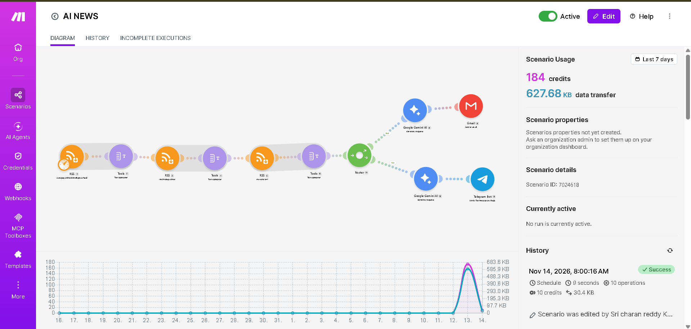
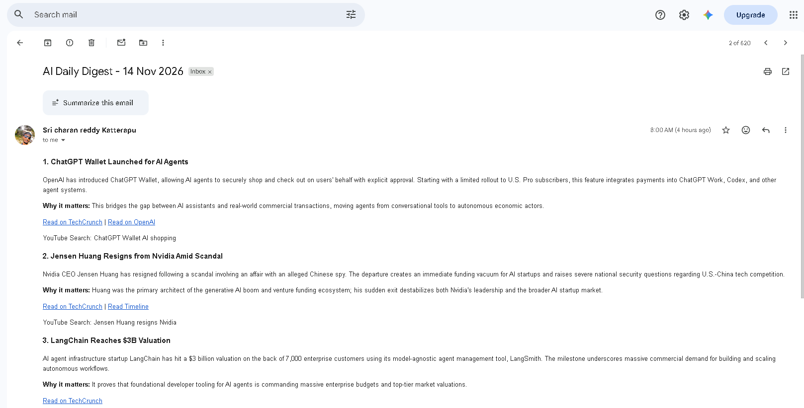

# 🚀 AI Daily Intelligence Automation

An AI-powered daily news automation system built using **Make.com and Google Gemini**. It collects AI-related news from multiple sources, processes the information using AI, and delivers daily intelligence reports through Gmail and Telegram.

## 🎯 Project Objective

Keeping up with the latest developments in Artificial Intelligence requires checking multiple news websites every day.

This project automates that process by collecting, analyzing, and distributing AI news through a scheduled workflow.

## ⚙️ Workflow Architecture

The automation follows this workflow:

RSS Feeds → Text Aggregators → Google Gemini → Router → Gmail / Telegram

### Workflow Breakdown

1. **News Collection:** Fetches AI news from multiple RSS feeds, including OpenAI, Google AI, and TechCrunch.
2. **Data Aggregation:** Combines the collected information using Text Aggregators.
3. **AI Processing:** Google Gemini analyzes and summarizes the collected news.
4. **Workflow Routing:** A Make.com Router distributes the generated reports into separate delivery paths.
5. **Email Delivery:** Sends a detailed AI newsletter through Gmail.
6. **Telegram Delivery:** Sends concise AI updates through a Telegram bot.
7. **Scheduling:** Executes automatically every day at 8:00 AM.

## 🛠️ Technologies Used

| Technology | Purpose |
|---|---|
| Make.com | Workflow automation and orchestration |
| Google Gemini | AI-powered news analysis |
| RSS Feeds | Automated news collection |
| Gmail | Newsletter delivery |
| Telegram Bot API | Automated notifications |

## 📸 Project Screenshots

### 1. Make.com Automation Workflow

### 2. Gmail Daily Newsletter

### 3. Telegram AI News Report

## 📚 Key Learnings

- Building automated workflows using Make.com.
- Integrating multiple RSS feeds.
- Connecting AI models with automation workflows.
- Using Text Aggregators and Routers.
- Integrating Gmail and Telegram.
- Configuring scheduled workflow execution.

## 🔮 Future Improvements

- Persistent duplicate news detection.
- Advanced news filtering and categorization.
- Improved AI-generated summaries.
- Additional notification channels.
- Enhanced error handling and monitoring.

## 🔐 Security

API keys, Telegram bot tokens, account credentials, and private configuration values are not included in this repository.

## 📌 Project Status

**Core automation implemented and successfully tested.**

Built as a hands-on project while exploring AI automation and workflow orchestration.
